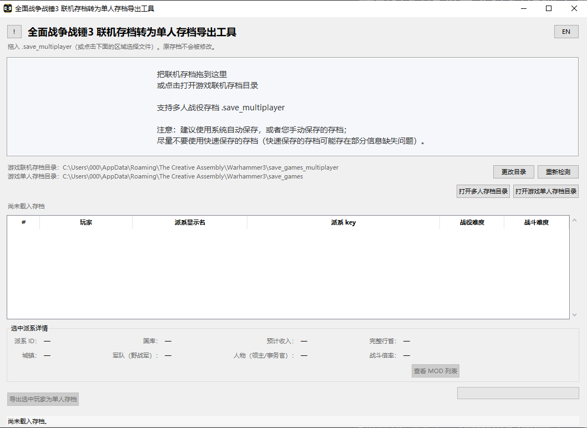
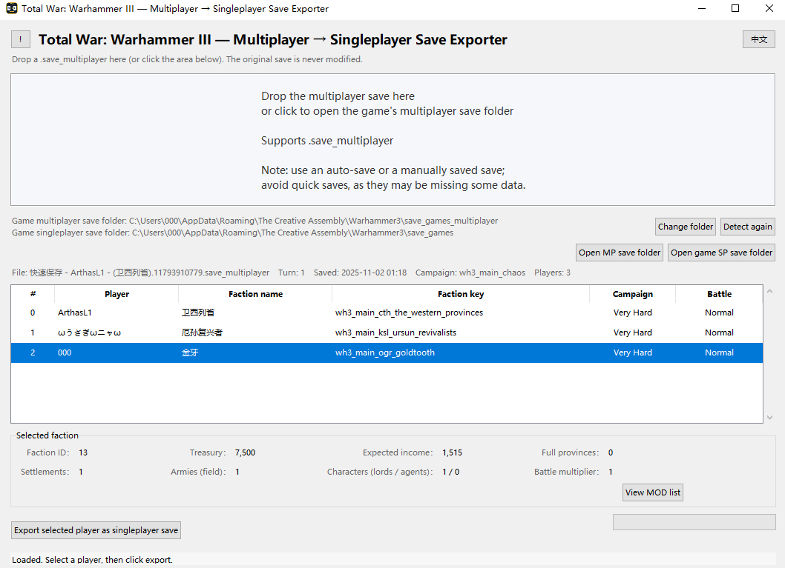
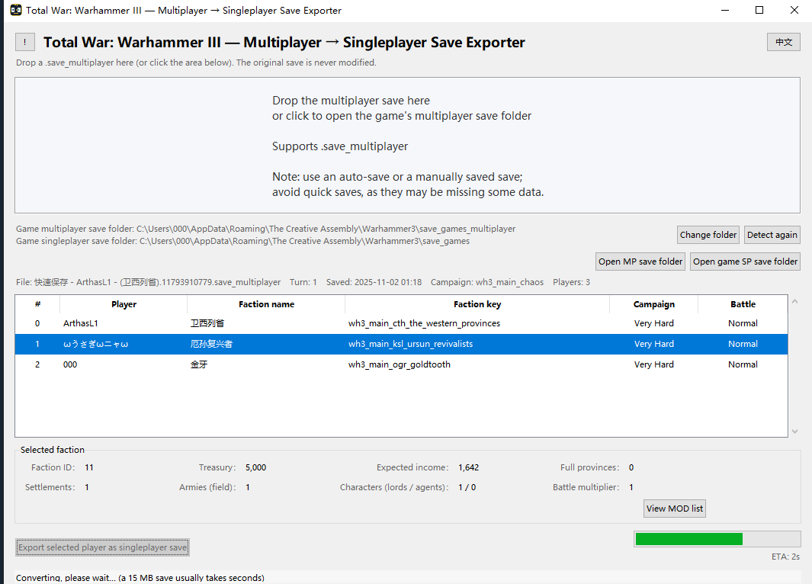
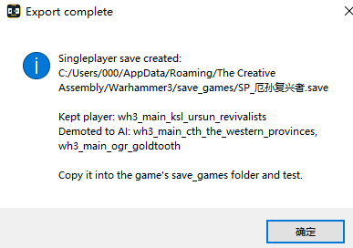

# Total War: WARHAMMER III — Multiplayer to Singleplayer Save Exporter

**English** | [中文](README.md)

## [⬇ Download here](https://github.com/UED000/WH3_MPTOSP/releases/latest)

- **Name / exe:** `WH3_MPTOSP` (Warhammer III Multiplayer to Singleplayer)
- **Version:** 1.0.0-beta.2
- **Author:** 000
- **Icon:** `WH3` on top with a two-card MP→SP icon below (used for both the exe and the window)

Double-click `WH3_MPTOSP.exe` to run. The original save is never modified; a new `.save` is created.

## Screenshots









## 1.0.0-beta.2: Save information and military AI

- The save information now shows **Game version**, the game build used when the save was last saved.
- 0.1.2 did not fix military AI for demoted player factions. This version fixes it: those factions now recruit and move armies normally.

The tool only reads the input save and creates a new singleplayer save. It does not modify or delete the original save.

## Save source note

Use a system auto-save or a manually saved save when possible. Avoid quick saves, as they may be missing some information.

## Usage

1. Download `WH3_MPTOSP.exe`, place it in any folder and double-click it. No installation required.
2. Drag a `.save_multiplayer` into the window, or click the hint area at the top to choose a file.
3. Select the player you want to continue as in the player list.
4. Click **Export selected player as singleplayer save**.
5. Choose the output location in the save dialog and wait for the export to finish. Saving directly into the game's singleplayer save folder is recommended.
6. Launch the game, open **Load Campaign** and select the newly exported `.save`.

The tool only reads the input save and creates a new singleplayer save. It does not modify or delete the original save.

## Does it work with more players?

Yes. It supports multiplayer saves. Choose any player to continue as; that player becomes the main player in the singleplayer campaign, and the other players' factions are handed over to the AI. The tool only reads the input save and creates a new singleplayer save. It does not modify or delete the original save.

## What you can see

- File name, current turn, save time, game version, campaign and player count;
- Player list: player name, faction display name, faction key, campaign difficulty and battle difficulty;
- Selected faction: faction ID, treasury, expected income, full provinces, settlements, field armies, characters (lords / agents) and battle multiplier;
- **View MOD list** shows the MODs used by the save.

### Data notes

- Expected income = income + trade - expense + base income from the save.
- Full provinces = provinces where the faction owns every region.
- Settlements = regions currently owned by the faction.
- Armies (field) = field armies led by lords, excluding garrisons.
- Characters (lords / agents) = number of lords / number of agents, excluding garrison commanders.

## MODs

If the original save uses MODs, enable the same MODs when loading the exported save. The tool preserves the save's MOD list.

## Build from source

Requires Python 3.9 + tkinter + PyInstaller:

```bat
python -m pip install pyinstaller tkinterdnd2
python -m PyInstaller --noconfirm --clean --onefile --windowed ^
  --name "WH3_MPTOSP" --icon app.ico --collect-all tkinterdnd2 mp2sp_gui.py
```

## Files

```
WH3_MPTOSP.exe             # Executable (included in releases)
app.ico                    # Application icon used when building
mp2sp_gui.py               # Program entry point
convert_mp_sp.py           # MP→SP conversion core
esf.py / tables.py         # Save reading/writing and game tables
faction_portraits.py       # Faction leader portrait paths
i18n.py / locdb.py         # Stubs
requirements.txt
README.md                  # Chinese README
README_EN.md               # English README
```

## License

Apache License 2.0. See `LICENSE`.

## Disclaimer

Unofficial fan tool, not endorsed by SEGA, Creative Assembly or Games Workshop. Total War: WARHAMMER and related names and assets belong to their respective owners. This tool does not contain game assets.
